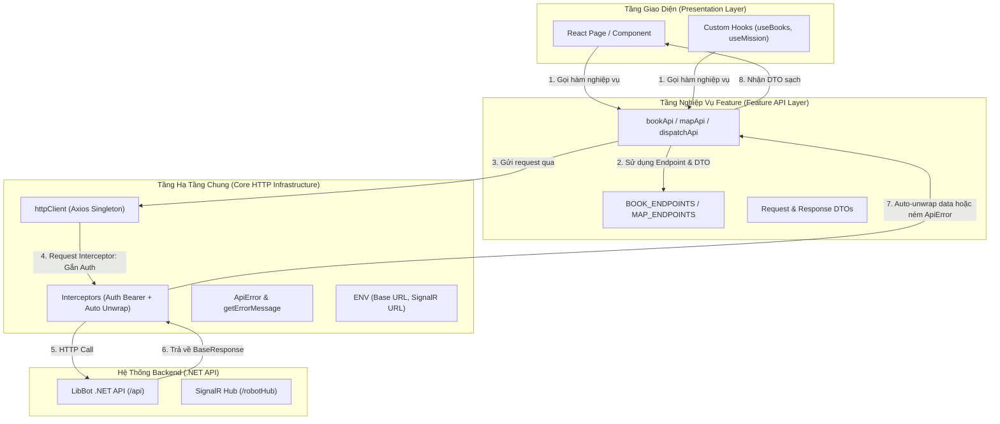

# Tiêu Chuẩn Kiến Trúc & Tích Hợp API (API Architecture Standard)

> **Dự án:** Libbot_FE  
> **Công nghệ:** React 19, TypeScript, Vite, Axios, SignalR  
> **Backend tương thích:** LibBot .NET Web API (`BaseResponse<T>`, `BookListResponse`)
> **Trạng thái tài liệu:** Đã duyệt kiến trúc - Chuẩn bị triển khai  

---

## 1. Tổng quan & Vấn đề Cần Giải Quyết

### 1.1. Hiện trạng codebase
Trong quá trình phát triển nhanh, tầng giao tiếp API của `Libbot_FE` đang gặp các vấn đề kỹ thuật sau:
1. **Trộn lẫn 2 cơ chế HTTP:** Vừa dùng `fetch` thủ công (trong `src/lib/bookApi.ts`, `shelfApi.ts`, `inventoryApi.ts`), vừa dùng `axios` (trong `src/features/maps/api/runtimeApi.ts`).
2. **Hardcode & Phân tán Base URL:** Một số file tự nối `import.meta.env.VITE_API_BASE_URL`, một số dùng relative path, dẫn đến khó đồng bộ với cấu hình proxy của `vite.config.ts`.
3. **Phụ thuộc chéo giữa các Feature (Coupling):** `src/features/dispatch/api.ts` phải import `apiClient` từ `src/features/maps/api/runtimeApi.ts`.
4. **Gọi API trực tiếp từ giao diện:** Một số component (như `LibraryPatrolMissionCreate.tsx`, `CreateMap.tsx`) đang gọi thẳng `apiClient.post(...)` thay vì qua tầng Service.
5. **Đoán mò định dạng lỗi:** Code kiểm tra lỗi phải viết nhiều điều kiện rườm rà (`if (typeof data === 'string')`, `if ('detail' in data)`).

### 1.2. Mục tiêu kiến trúc mới
- **Thống nhất 1 Client duy nhất:** Toàn bộ dự án sử dụng chung một `httpClient` cấu hình chuẩn qua Axios.
- **Tự động bóc tách (Auto-unwrap) Data:** Nhận diện và trích xuất trực tiếp `data` từ `BaseResponse<T>` của Backend.
- **Xử lý lỗi chuẩn xác:** Trích xuất thông điệp lỗi trực tiếp từ thuộc tính `message` của Backend, không đoán mò format.
- **Endpoint Co-location:** Mỗi feature tự quản lý endpoint của mình, triệt tiêu nguy cơ xung đột Git (merge conflicts).
- **Phân lớp rành mạch (Separation of Concerns):** Component UI chỉ làm nhiệm vụ hiển thị và tương tác người dùng, không quan tâm chi tiết HTTP.

---

## 2. Kiến trúc Phân Tầng (Layered Architecture)

Luồng dữ liệu đi qua 4 tầng độc lập theo chiều một chiều:



---

## 3. Cấu Trúc Thư Mục Chuẩn (Directory Structure)

```text
src/
├── config/
│   └── env.ts                      # Cấu hình biến môi trường tập trung
├── types/
│   └── api.ts                      # BaseResponse<T>, PaginatedData<T>, PaginationParams
├── services/                       # Hạ tầng dùng chung (Core Services)
│   ├── http/
│   │   ├── client.ts               # Axios instance duy nhất, Interceptors
│   │   └── error.ts                # Class ApiError & hàm getErrorMessage
│   └── signalr/
│       └── signalRClient.ts        # Quản lý WebSocket / SignalR dùng chung
└── features/                       # Các module nghiệp vụ (Co-location)
    ├── books/
    │   ├── api/
    │   │   ├── endpoints.ts        # Routes riêng của feature Books
    │   │   └── bookApi.ts          # Các hàm gọi API (getAll, getById, create, ...)
    │   ├── types/
    │   │   └── book.ts             # DTOs: BookRecord, BookWriteRequest, ...
    │   └── components/             # UI components riêng của Books
    ├── maps/
    │   ├── api/
    │   │   ├── endpoints.ts
    │   │   └── mapApi.ts
    │   ├── types/
    │   └── components/
    ├── dispatch/
    │   ├── api/
    │   │   ├── endpoints.ts
    │   │   └── dispatchApi.ts
    │   ├── types/
    │   └── components/
    └── ...
```

> [!IMPORTANT]
> **Tại sao không gom toàn bộ endpoint vào 1 file `src/services/endpoints/index.ts`?**  
> 1. **Tránh Git Merge Conflict:** Khi nhiều thành viên cùng phát triển các tính năng khác nhau, việc cùng sửa một file index sẽ gây xung đột code liên tục.  
> 2. **Tính đóng gói (Co-location):** Khi làm việc với feature `books`, dev chỉ cần thao tác trong thư mục `src/features/books/`. Khi muốn xóa hoặc refactor feature đó, việc dọn dẹp diễn ra trọn gói trong một thư mục duy nhất.

---

## 4. Đặc Tả Dữ Liệu Backend & TypeScript Types

### 4.1. Hợp đồng dữ liệu từ Backend (`src/types/api.ts`)
Backend LibBot (`LiBot_BE`) sử dụng `BaseResponse<T>` làm chuẩn đóng gói cho toàn bộ API:

```typescript
// src/types/api.ts

/**
 * Định dạng phản hồi chuẩn từ Backend .NET (BaseResponse.cs)
 */
export interface BaseResponse<T> {
  success: boolean
  message: string | null
  data: T
}

/**
 * Định dạng chuẩn cho dữ liệu danh sách có phân trang (BookListResponse.cs)
 */
export interface PaginatedData<T> {
  items: T[]
  page: number
  pageSize: number
  totalCount: number
  totalPages: number
  sortBy: string
  sortOrder: 'asc' | 'desc' | string
}

/**
 * Query params chuẩn khi gửi yêu cầu phân trang lên server
 */
export interface PaginationParams {
  page?: number
  pageSize?: number
  searchTerm?: string
  sortBy?: string
  sortOrder?: 'asc' | 'desc'
}
```

---

## 5. Tầng Hạ Tầng Cốt Lõi (Core HTTP Infrastructure)

### 5.1. Quản lý Môi trường (`src/config/env.ts`)
Đảm bảo hoạt động trơn tru cả ở môi trường phát triển (qua Vite Proxy) và môi trường production (URL trực tiếp):

```typescript
// src/config/env.ts
export const ENV = {
  // Mặc định '/api' để khớp với server.proxy trong vite.config.ts
  API_BASE_URL: import.meta.env.VITE_API_BASE_URL?.replace(/\/$/, '') || '/api',
  SIGNALR_URL: import.meta.env.VITE_SIGNALR_URL || '/robotHub',
  IS_DEV: import.meta.env.DEV,
} as const
```

### 5.2. Chuẩn hóa Lỗi (`src/services/http/error.ts`)
Không còn phải đoán mò kiểu dữ liệu; ta đọc trực tiếp thuộc tính `message` do Backend cung cấp:

```typescript
// src/services/http/error.ts
import axios from 'axios'
import type { BaseResponse } from '@/types/api'

export class ApiError extends Error {
  statusCode: number
  success: boolean

  constructor(message: string, statusCode = 500) {
    super(message)
    this.name = 'ApiError'
    this.statusCode = statusCode
    this.success = false
  }
}

/**
 * Rút trích message chuẩn xác để hiển thị thông báo (Toast/Alert) trên UI
 */
export function getErrorMessage(error: unknown, fallback = 'Đã có lỗi xảy ra. Vui lòng thử lại.'): string {
  if (error instanceof ApiError) {
    return error.message
  }

  if (axios.isAxiosError<BaseResponse<unknown>>(error)) {
    // 1. Backend trả về BaseResponse có chứa message (400, 404, validation error...)
    const resData = error.response?.data
    if (resData && typeof resData === 'object' && 'message' in resData && resData.message) {
      return resData.message
    }

    // 2. Trường hợp lỗi hệ thống từ ExceptionMiddleware (500)
    if (resData && typeof resData === 'object' && 'error' in resData) {
      return (resData as { error: string }).error
    }

    if (error.response?.status === 404) return 'Không tìm thấy dữ liệu yêu cầu (404)'
    if (error.response?.status === 500) return 'Máy chủ gặp sự cố nội bộ (500)'
  }

  return error instanceof Error ? error.message : fallback
}
```

### 5.3. Axios Instance & Auto-Unwrap (`src/services/http/client.ts`)
Tự động bóc tách vỏ `BaseResponse<T>`, giúp UI nhận thẳng `data: T` mà không cần viết `.data.data`:

```typescript
// src/services/http/client.ts
import axios from 'axios'
import type { AxiosResponse } from 'axios'
import { ENV } from '@/config/env'
import { ApiError } from './error'
import type { BaseResponse } from '@/types/api'

export const httpClient = axios.create({
  baseURL: ENV.API_BASE_URL,
  timeout: 15000,
  headers: {
    'Content-Type': 'application/json',
    Accept: 'application/json',
  },
})

// Request Interceptor: Tự động đính kèm Token xác thực
httpClient.interceptors.request.use((config) => {
  const token = localStorage.getItem('access_token')
  if (token && config.headers) {
    config.headers.Authorization = `Bearer ${token}`
  }
  return config
})

// Response Interceptor: Tự động unwrap BaseResponse
httpClient.interceptors.response.use(
  (response: AxiosResponse<BaseResponse<unknown>>) => {
    const payload = response.data

    // Nếu dữ liệu trả về theo format BaseResponse chuẩn
    if (payload && typeof payload === 'object' && 'success' in payload) {
      if (!payload.success) {
        throw new ApiError(payload.message || 'Yêu cầu không thành công', response.status)
      }
      // Trả về trực tiếp phần payload.data
      return payload.data as any
    }

    // Trường hợp raw binary, blob, camera stream...
    return response.data
  },
  (error) => {
    if (axios.isAxiosError<BaseResponse<unknown>>(error)) {
      const serverMsg =
        error.response?.data?.message ||
        (error.response?.data as { error?: string })?.error ||
        'Lỗi kết nối máy chủ'
      return Promise.reject(new ApiError(serverMsg, error.response?.status ?? 500))
    }
    return Promise.reject(new ApiError(error.message || 'Lỗi không xác định'))
  },
)
```

---

## 6. Mẫu Thiết Kế Feature Chuẩn (Feature Blueprint)

Ví dụ chi tiết cách triển khai cho Feature **`books`**:

### 6.1. Định nghĩa Endpoints (`src/features/books/api/endpoints.ts`)
```typescript
// src/features/books/api/endpoints.ts
export const BOOK_ENDPOINTS = {
  LIST: '/books',
  DETAIL: (id: string) => `/books/${encodeURIComponent(id)}`,
  CATEGORIES: '/books/categories',
  CATEGORY_DETAIL: (id: string) => `/books/categories/${encodeURIComponent(id)}`,
} as const
```

### 6.2. Định nghĩa DTOs (`src/features/books/types/book.ts`)
```typescript
// src/features/books/types/book.ts
export interface BookRecord {
  id: string
  categoryId: string | null
  isbn: string
  title: string
  author: string
  publisher: string | null
  publicationYear: number | null
  image: string | null
  description?: string | null
}

export interface BookCategoryRecord {
  id: string
  name: string
  description: string | null
}

export interface BookWriteRequest {
  categoryId: string | null
  isbn: string
  title: string
  author: string
  publisher: string | null
  publicationYear: number | null
  image: string | null
  description?: string | null
}
```

### 6.3. Tầng Service (`src/features/books/api/bookApi.ts`)
```typescript
// src/features/books/api/bookApi.ts
import { httpClient } from '@/services/http/client'
import { BOOK_ENDPOINTS } from './endpoints'
import type { PaginatedData, PaginationParams } from '@/types/api'
import type { BookCategoryRecord, BookRecord, BookWriteRequest } from '../types/book'

export const bookApi = {
  /** Lấy danh sách sách có phân trang */
  getBooks: (params?: PaginationParams): Promise<PaginatedData<BookRecord>> => {
    return httpClient.get(BOOK_ENDPOINTS.LIST, { params })
  },

  /** Xem chi tiết 1 cuốn sách */
  getBookById: (id: string): Promise<BookRecord> => {
    return httpClient.get(BOOK_ENDPOINTS.DETAIL(id))
  },

  /** Tạo sách mới */
  createBook: (payload: BookWriteRequest): Promise<BookRecord> => {
    return httpClient.post(BOOK_ENDPOINTS.LIST, payload)
  },

  /** Cập nhật thông tin sách */
  updateBook: (id: string, payload: BookWriteRequest): Promise<BookRecord> => {
    return httpClient.put(BOOK_ENDPOINTS.DETAIL(id), payload)
  },

  /** Xóa sách */
  deleteBook: (id: string): Promise<void> => {
    return httpClient.delete(BOOK_ENDPOINTS.DETAIL(id))
  },

  /** Lấy danh mục sách */
  getCategories: (): Promise<BookCategoryRecord[]> => {
    return httpClient.get(BOOK_ENDPOINTS.CATEGORIES)
  },
}
```

### 6.4. Sử dụng tại React Component (`src/pages/books/BookList.tsx`)
```tsx
// src/pages/books/BookList.tsx
import { useEffect, useState } from 'react'
import { bookApi } from '@/features/books/api/bookApi'
import { getErrorMessage } from '@/services/http/error'
import type { BookRecord } from '@/features/books/types/book'

export function BookList() {
  const [books, setBooks] = useState<BookRecord[]>([])
  const [totalPages, setTotalPages] = useState(1)
  const [isLoading, setIsLoading] = useState(false)
  const [error, setError] = useState<string | null>(null)

  useEffect(() => {
    async function loadBooks() {
      try {
        setIsLoading(true)
        setError(null)
        // Dữ liệu trả về thẳng PaginatedData<BookRecord> đã được unwrap
        const data = await bookApi.getBooks({ page: 1, pageSize: 20 })
        setBooks(data.items)
        setTotalPages(data.totalPages)
      } catch (err) {
        // Rút trích đúng message lỗi của Backend
        setError(getErrorMessage(err))
      } finally {
        setIsLoading(false)
      }
    }

    loadBooks()
  }, [])

  if (isLoading) return <div>Đang tải dữ liệu...</div>
  if (error) return <div className="text-red-500 font-medium">{error}</div>

  return (
    <div>
      <h2 className="text-xl font-bold">Danh sách sách (Tổng số trang: {totalPages})</h2>
      <ul>
        {books.map((book) => (
          <li key={book.id}>{book.title} - {book.author}</li>
        ))}
      </ul>
    </div>
  )
}
```

---

## 7. Kế Hoạch Triển Khai 4 Giai Đoạn (Implementation Roadmap)

| Giai đoạn | Nội dung chính | Kết quả đầu ra |
| :--- | :--- | :--- |
| **Giai đoạn 1: Core Infra** | 1. Tạo `src/config/env.ts`<br/>2. Tạo `src/types/api.ts`<br/>3. Tạo `src/services/http/error.ts`<br/>4. Tạo `src/services/http/client.ts` | Tầng hạ tầng HTTP sẵn sàng hoạt động với auto-unwrap và type-safe. |
| **Giai đoạn 2: Reference Feature** | 1. Xây dựng feature mẫu `src/features/books/`<br/>2. Chuyển logic từ `src/lib/bookApi.ts` sang `src/features/books/api/bookApi.ts`<br/>3. Refactor các trang `BookList.tsx`, `BookDetail.tsx` | Feature mẫu hoàn thiện, kiểm chứng thực tế tính tiện dụng. |
| **Giai đoạn 3: Migration toàn diện** | 1. Chuyển `src/features/maps` và `src/features/dispatch` dùng chung `httpClient`<br/>2. Tách `endpoints.ts` cho Maps & Dispatch<br/>3. Di chuyển `shelfApi.ts`, `inventoryApi.ts`, `missionApi.ts` từ `src/lib/` về các feature tương ứng | Toàn bộ ứng dụng sử dụng chung 1 client, xóa bỏ coupling giữa các feature. |
| **Giai đoạn 4: Clean up & Testing** | 1. Chạy `npm run build` (`tsc`) để rà soát lỗi type<br/>2. Chạy `npm run test` (Vitest)<br/>3. Xóa các file `*Api.ts` thừa trong `src/lib/` | Build 100% clean, không còn `fetch` thủ công hoặc import sai lệch. |

---

## 8. Quy Ước Code Cho Đội Ngũ Lập Trình (Developer Guidelines)

1. **Quy tắc 3 tầng (Layering Boundary):**
   - Tuyệt đối **không gọi trực tiếp** `httpClient.get/post` hoặc `fetch()` trong component/page.
   - Component chỉ được gọi thông qua các hàm Service trong thư mục `api/`.
2. **Quy tắc `verbatimModuleSyntax`:**
   - Dự án bật `"verbatimModuleSyntax": true` trong `tsconfig.json`. Mọi import chỉ dùng cho định nghĩa type bắt buộc phải viết: `import type { ... }`.
3. **Mã hóa URL an toàn:**
   - Khi nối param động vào endpoint, luôn dùng `encodeURIComponent(id)` để tránh lỗi URL injection hoặc kí tự đặc biệt (`/`, `?`, `#`).
4. **Xử lý lỗi thống nhất:**
   - Trong khối `catch (err)`, luôn dùng hàm `getErrorMessage(err)` để lấy chuỗi text thông báo cho người dùng.
